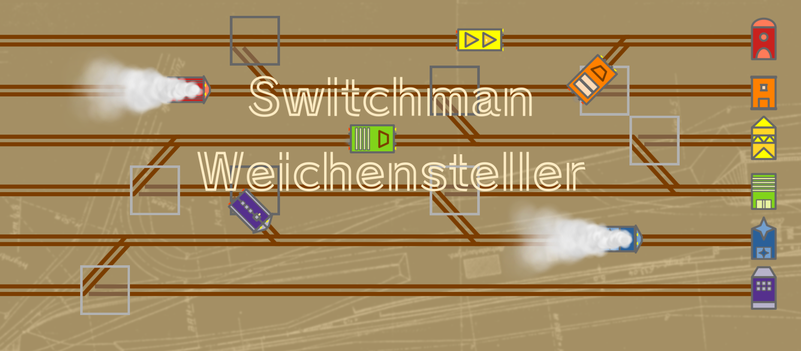

# Weichensteller / Switchman

 

## The Game

Just go to [https://weichensteller.online/](https://weichensteller.online/play) and wait for the game to load.

The rules are simple: Click on the switches to guide the trains to the right destinations (with matching colors).
It starts slowly but gets faster and harder over time. Hurry up to set up the correct path!

You can have your score saved online. Just enter your name and select your age. (There are differentt lists for different ages to give minors a chance to get to the top. Just be honest!)

## The Source Code

### Dependencies

* Godot 4 (version 4.7)
* ImageMagick (version 6.9; montage, convert)
* Inkscape (version 1.2)
* LibreOffice (version 26.2; soffice)
* pdf2svg (version 0.2.3)

### Prepare for Godot import

1. Run `./images/odg/process-images.sh`
2. Run `./images/icons/create-icons.sh`
3. Run `./images/sources/create-background.sh`
4. Run `cp server/credentials.json.example server/credentials.json`
5. Start Godot and import the project.
6. If you want to export for Android, use "Project > Install Android Build Template…"
7. If you want to use online highscore, edit `server/credentials.json`.

### Run

You should be able to run the project (`F5` key) or to export it ("Project > Export…"). The exported game will be located at `bin/`.

### Contribute

Feel free to create a pull request.
